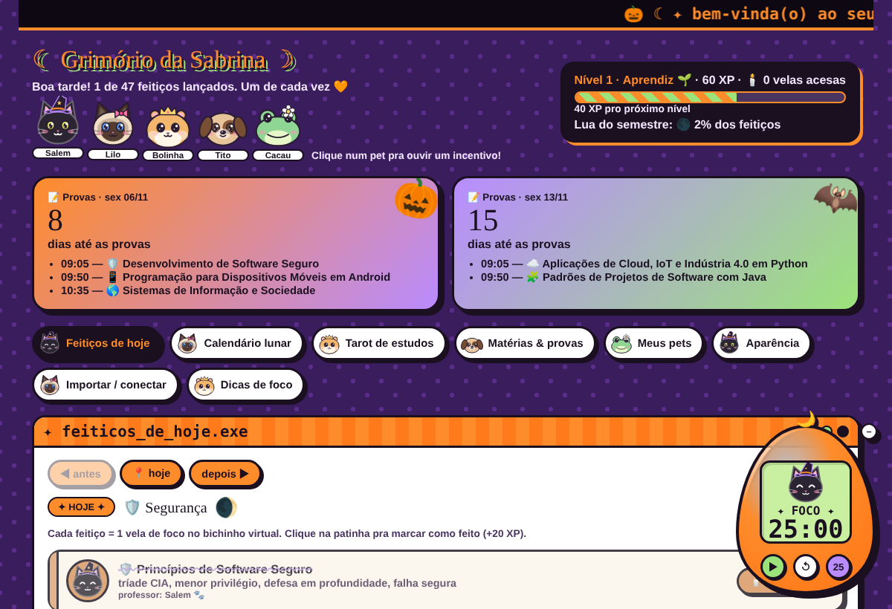

# ☾ Grimório ☽ — planner de estudos kawaii

> 🇧🇷 Português · [🇺🇸 English below](#-english)

Um planner de estudos **fofo, mágico e anos 90**, feito para quem tem dificuldade de foco.
Seus pets viram professores, cada tarefa é um feitiço e o timer é um bichinho virtual. 🐾🔮



## ✨ O que ele faz

- **Plano de estudos automático**: você cadastra matérias, temas e provas. O Grimório espalha os temas nos dias antes de cada prova e deixa a véspera para uma revisão leve.
- **Feitiços de hoje**: poucas tarefas por dia, com XP, níveis (de Aprendiz a Arquimaga 👑) e luas que vão enchendo 🌑→🌕.
- **Bichinho virtual (timer de foco)**: estilo tamagotchi, em 5 formatos (ovo, coração, chapéu de bruxa, estrela e lua). Seu pet dorme na pausa 😴.
- **Tarot de estudos (flashcards)**: as cartas que você erra voltam mais vezes.
- **Pets personalizáveis**: gato, cachorro, ratinho, hamster, coelho, galinha, pato, passarinho, cobra, tartaruga, sapo, peixe, morcego e raposa. Você escolhe cores, padrão ou raça (tigrado, siamês, frajola, pintado…), cor dos olhos e acessório (chapéu de bruxa, laço, coroa…).
- **Temas de cores**: Halloween, Kawaii amarelo, Pastel goth, Floresta, Oceano, Morango, Noite estrelada. Você também pode montar suas próprias cores.
- **Conectar com a sua instituição**: copie e cole o texto do portal (sem senha!). Também importa `.csv`, calendário `.ics` (Google Agenda, Outlook, Moodle) e backup `.json`.
- **Português e inglês**, funciona **offline** e pode ser **instalado** como app (PWA).

## 🔒 Seus dados: privacidade e proteção contra perda

O Grimório é **local-first**: funciona sem internet e sem conta, e você não perde nada à toa.

| Camada | O que faz |
|---|---|
| 📦 Navegador | Salva no `localStorage` **e** numa cópia em **IndexedDB**. Se uma for apagada, o app recupera da outra. Também pede **armazenamento persistente** ao navegador. |
| 🛟 Cópias automáticas | Antes de importar, restaurar ou baixar da nuvem, guarda uma cópia de segurança que dá pra restaurar com um clique. |
| 💾 Backup automático em arquivo | No Chrome e no Edge, escolha um arquivo no seu computador e o Grimório salva nele a cada mudança. |
| ☁️ Nuvem (opcional) | Login por link mágico no e-mail e sincronização entre celular e PC via **Supabase (Postgres)**. Cada pessoa só acessa os próprios dados (Row Level Security). Veja [docs/SUPABASE.md](docs/SUPABASE.md). |
| 📤 Exportar / importar | Backup `.json` manual a qualquer momento. Se faltar backup, um lembrete aparece depois de 7 dias. |

## 🚀 Como usar

- **Online:** <https://sabrinadandrade.github.io/grimorio/>
- **No seu computador:** baixe o projeto (botão verde *Code → Download ZIP*), descompacte e abra o `index.html`. Não precisa instalar nada.

## 🎓 Instituições suportadas

| Instituição | Como importar |
|---|---|
| ✨ Qualquer uma / uso pessoal | Cole linhas como `Cálculo I - 06/11 09:00 - Sala 12`, ou importe `.csv`/`.ics` |
| 🎓 Estácio (Sala de Aula Virtual) | Copie a página **Início** (provas) e as páginas **Conteúdos** (temas) |

Sua faculdade não está na lista? **Crie um conector!** É um arquivo JavaScript pequeno. Veja o [CONTRIBUTING.md](CONTRIBUTING.md).

## 🧱 Tecnologia

HTML + CSS + JavaScript puro. Sem framework e sem etapa de build. Para contribuir, basta um editor de texto e um navegador.

```
index.html
css/style.css
js/
  i18n.js          traduções (pt, en)
  themes.js        temas de cores
  pets.js          gerador de pets em SVG
  store.js         dados (localStorage)
  safety.js        IndexedDB, backup automático, cópias de segurança
  cloud.js         sincronização com Supabase (opcional)
  config.js        URL e chave pública do Supabase
  planner.js       gerador do plano de estudos
  importers.js     json, csv, ics
  connectors/      um arquivo por instituição
  tama.js          bichinho virtual / timer
  fx.js            efeitos (estrelinhas, balões)
  app.js           interface
examples/          pacotes de exemplo
```

## 💜 Contribuindo

Ideias, pets novos, temas, traduções e conectores são muito bem-vindos! Leia o [CONTRIBUTING.md](CONTRIBUTING.md).

Licença [MIT](LICENSE).

---

## 🇺🇸 English

A **cute, magical, 90s-style** study planner for people who struggle to focus.
Your pets become teachers, every task is a spell, and the focus timer is a virtual pet. 🐾🔮

- **Automatic study plan**: spreads topics over the days before each exam and keeps the day before for light review.
- **Today's spells**: a few tasks per day, plus XP, levels and moon phases 🌑→🌕.
- **Virtual pet focus timer**: tamagotchi style, in egg, heart, witch hat, star and moon shapes.
- **Study tarot (flashcards)**: cards you miss come back more often.
- **Custom pets**: 14 species, with your choice of colors, patterns or breeds, eye color and accessories.
- **Color themes**: 7 presets, plus fully custom colors.
- **Connect your school**: paste text copied from the portal (no passwords), or import `.csv`, `.ics` or `.json`.
- **Portuguese and English**, works **offline** and can be installed as a PWA.
- **No data loss**: data is mirrored to IndexedDB, auto-backed-up to a local file, and optionally synced to the cloud with **Supabase** (magic-link login plus Row Level Security). See [docs/SUPABASE.md](docs/SUPABASE.md).

To use it, open <https://sabrinadandrade.github.io/grimorio/> or download the project and open `index.html`.
To contribute (connectors, pets, themes, translations), see [CONTRIBUTING.md](CONTRIBUTING.md). License: MIT.
