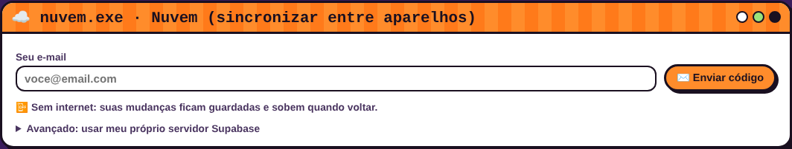

# ☾ Tutorial do Grimório ☽ (passo a passo para iniciantes)

Oi! 💜 Este guia explica **tudo** sobre o Grimório, sem termos difíceis. Não precisa saber nada de computador: é só seguir na ordem.

> **Resumo em 1 minuto:** abra o site → coloque seu nome → cadastre (ou importe) suas matérias e provas → clique em **✨ Gerar plano** → todo dia abra **Feitiços de hoje** e faça um feitiço de cada vez, com o timer. Pronto!

### Sumário
1. [O que é o Grimório](#1-o-que-é-o-grimório)
2. [Como abrir (computador, iPhone e Android)](#2-como-abrir)
3. [Primeira vez: boas-vindas](#3-primeira-vez-boas-vindas)
4. [Colocar suas matérias e provas](#4-colocar-suas-matérias-e-provas)
5. [Importar da sua faculdade, escola ou curso](#5-importar-da-sua-faculdade-escola-ou-curso)
6. [Gerar o plano de estudos](#6-gerar-o-plano-de-estudos)
7. [Usar no dia a dia: Feitiços de hoje](#7-usar-no-dia-a-dia-feitiços-de-hoje)
8. [O bichinho virtual (timer de foco)](#8-o-bichinho-virtual-timer-de-foco)
9. [Calendário lunar](#9-calendário-lunar)
10. [Tarot de estudos (flashcards)](#10-tarot-de-estudos-flashcards)
11. [O que cai](#11-o-que-cai)
12. [Seus pets](#12-seus-pets)
13. [Aparência: cores e formato do bichinho](#13-aparência)
14. [Seus dados: backup e nuvem (não perca nada!)](#14-seus-dados-backup-e-nuvem)
15. [Usar no computador e no celular ao mesmo tempo](#15-usar-no-computador-e-no-celular-ao-mesmo-tempo)
16. [Problemas comuns (e como resolver)](#16-problemas-comuns)
17. [Dicionário de palavras difíceis](#17-dicionário-de-palavras-difíceis)

---

## 1. O que é o Grimório

É um **planner de estudos**: ele organiza **o que estudar em cada dia** até as suas provas. Ele foi feito para quem tem **dificuldade de foco**:

- cada dia tem **poucas tarefas** (chamadas de **feitiços** 🔮);
- tem um **timer** em forma de bichinho virtual, que ajuda a focar por alguns minutos e depois descansar;
- você ganha **XP** e sobe de nível, e a **lua** vai enchendo 🌑→🌕 conforme você cumpre as tarefas;
- seus **pets** viram professores e torcem por você 🐾.

É **grátis**, não tem propaganda e funciona **até sem internet**.

---

## 2. Como abrir

### No computador
1. Abra o navegador (Chrome, Edge, Opera, Firefox…).
2. Entre em **https://sabrinadandrade.github.io/Grimorio/**
3. Dica: aperte **Ctrl + D** para salvar nos favoritos.

> **Quer um ícone na área de trabalho?** No Chrome/Edge, clique nos **três pontinhos ⋮ → Transmitir, salvar e compartilhar → Instalar página como app** (ou o ícone de "instalar" na barra de endereço). O Grimório vira um programinha com ícone próprio.

### No iPhone (iOS)
1. Abra o link acima no **Safari** (tem que ser o Safari).
2. Toque no botão **Compartilhar** (o quadrado com uma setinha para cima ⬆️).
3. Role e toque em **Adicionar à Tela de Início** → **Adicionar**.
4. Pronto: aparece o ícone do gatinho de chapéu na sua tela, igual um app. 🐈‍⬛

<a id="android-app"></a>
### No Android: baixar o app (APK) 📱
1. No celular, abra **https://github.com/sabrinadandrade/Grimorio/releases/latest**
2. Lá embaixo, em **Assets**, toque em **Grimorio.apk** para baixar.
3. Quando terminar, toque na notificação do download (ou abra o app **Arquivos → Downloads** e toque em **Grimorio.apk**).
4. Na **primeira vez**, o Android avisa que o app não veio da Play Store. Toque em **Configurações** → ative **Permitir desta fonte** → volte e toque em **Instalar**.
5. Pronto: o gatinho de chapéu aparece na sua tela! 🐈‍⬛

> 🔄 **Atualizar:** baixe o **Grimorio.apk** de novo pelo mesmo link e instale por cima. Seus dados continuam lá (e, se você usa a nuvem, ficam salvos de qualquer jeito).

> **Prefere não instalar nada?** Abra o site no **Chrome** → **três pontinhos ⋮** → **Adicionar à tela inicial**. Funciona igualzinho.

---

## 3. Primeira vez: boas-vindas

Na primeira vez aparece esta janela:


- **Seu nome:** o título vira "Grimório **da** Ana", por exemplo.
- **Artigo:** escolha **da**, **do** ou **de**, como você preferir.
- **Idioma:** português ou inglês.
- Clique em **Começar ✨**.

No começo o grimório está vazio. Os botões levam você para o próximo passo:


---

## 3.1 Não é só para a faculdade! 💜

"Matéria" no Grimório pode ser **qualquer área da sua vida**, e "prova" pode ser **qualquer data importante**. Exemplos:

| Matéria | Temas (viram feitiços) | "Prova" (data-alvo) |
|---|---|---|
| 🧘 Saúde | Marcar dentista · Caminhar 3x · Beber água | Consulta no dia 20 |
| 🏠 Casa | Organizar guarda-roupa · Limpar geladeira | Visita da família |
| 💰 Finanças | Listar gastos · Montar orçamento | Dia de pagar contas |
| 🎸 Curso livre / hobby | Aula 1 · Aula 2 · Praticar | Apresentação |
| 📚 Concurso / ENEM | Português · Matemática · Redação | Dia da prova |

E para coisas soltas do dia, use o **feitiço extra** na aba **Feitiços de hoje** ([passo 7](#7-usar-no-dia-a-dia-feitiços-de-hoje)).

---

## 4. Colocar suas matérias e provas

Abra a aba **Matérias & provas** (os botões redondos com um pet são as **abas**).

### 4.1 Criar uma matéria
1. Clique em **+ Nova matéria**.
2. Clique no nome da matéria para abrir e preencha:
   - **Nome** (ex.: Cálculo I) e **Nome curto** (ex.: Cálculo);
   - **Emoji** e **Cor**, para deixar bonito;
   - **Pet professor**: qual pet "dá aula" dessa matéria;
   - **Temas**: **um por linha**. Se quiser uma explicação, use uma barra em pé: `Derivadas | regras básicas`;
   - **O que cai / anotações**: dicas sobre a prova.


> 💡 **Os temas são o mais importante!** É com eles que o Grimório monta o plano. Copie os temas do plano de ensino ou do sumário da apostila.

Tudo é **salvo sozinho**, não precisa apertar "salvar".

### 4.2 Cadastrar as provas
Na janela **provas.exe**, clique em **+ Nova prova** e escolha a **matéria**, a **data**, a **hora** e o **local**.


---

## 5. Importar da sua faculdade, escola ou curso

Não quer digitar tudo? Vá na aba **Importar / conectar**. Tem 4 jeitos. **Nenhum pede a senha da sua faculdade.** 🔒

### Jeito 1: colar o texto (qualquer instituição ou uso pessoal)
1. Em **Instituição**, deixe **✨ Qualquer instituição / uso pessoal**.
2. Escreva ou cole na caixa, **uma informação por linha**:

| Se você escrever… | Vira… |
|---|---|
| `Cálculo I - 06/11 09:00 - Sala 12` | 📝 prova (matéria, data, hora e local) |
| `Física` e, na linha de baixo, `13/11 às 10h30` | 📝 prova de Física |
| `O que é derivada? ;; Taxa de variação` | 🃏 carta do tarot (pergunta **;;** resposta) |
| `Limites e continuidade` (sem data) | ✨ tema (o app pergunta de qual matéria) |

3. Clique em **🔍 Analisar texto**. O Grimório mostra o que encontrou **antes** de adicionar.
4. Se estiver certo, clique em **✅ Adicionar ao meu grimório**.


### Jeito 2: Estácio (Sala de Aula Virtual)
1. Em **Instituição**, escolha **🎓 Estácio**.
2. Em outra aba do navegador, entre em **estudante.estacio.br** normalmente.
3. Na página **Início**, aperte **Ctrl + A** (seleciona tudo) e depois **Ctrl + C** (copia).
4. Volte ao Grimório, clique na caixa, aperte **Ctrl + V** (cola) e depois **Analisar texto**. Ele encontra suas **disciplinas** e **provas agendadas**.
5. **Para os temas:** abra a disciplina → **Conteúdos** → clique em **"Mostrar mais"** até aparecer tudo → **Ctrl + A**, **Ctrl + C** → cole no Grimório. Ele pergunta de qual matéria são os temas.


### Jeito 3: planilha (Excel / Google Planilhas)
1. Clique em **📄 Baixar modelo CSV** (janela **arquivos.exe**).
2. Abra o arquivo no Excel ou no Google Planilhas. Cada linha é uma coisa:
   - `prova` → preencha **materia, data, hora, local**
   - `tema` → preencha **materia, titulo, detalhe**
   - `carta` → preencha **materia, pergunta, resposta**
3. Salve como **CSV** e clique em **📂 Importar arquivo**.

### Jeito 4: calendário (.ics)
Se suas provas já estão no **Google Agenda**, **Outlook**, **Moodle**, **Canvas** ou **Teams**, exporte o calendário (procure por "Exportar" ou "Exportar calendário"; o arquivo termina em **.ics**) e clique em **📂 Importar arquivo**. Cada evento vira uma prova.


> 🤖 **Dica:** tem o plano de ensino em PDF? Peça a uma IA que você já usa (ChatGPT, Claude, Gemini…): *"transforme isso no formato do modelo CSV do Grimório, com as colunas tipo, materia, data, hora, local, titulo, detalhe, pergunta, resposta"*. Depois é só importar o arquivo. (O Grimório **não** usa nenhuma IA por dentro.)

> 👯 **Estudando com a turma?** Uma pessoa monta tudo, clica em **💾 Exportar backup** e manda o arquivo. Os colegas clicam em **📂 Importar arquivo** e recebem as matérias, os temas, as provas e as cartas prontos.

---

## 6. Gerar o plano de estudos

Na aba **Matérias & provas**, desça até **plano_de_estudos.exe**:


- **Feitiços por dia:** quantas tarefas por dia. Para quem tem dificuldade de foco, **2 ou 3** é ótimo.
- **Começar em:** deixe vazio para começar hoje.
- **Minutos de foco / pausa:** o tempo do timer (25 e 5 é o clássico).
- Clique em **✨ Gerar / atualizar plano**.

O Grimório espalha os temas de cada matéria nos dias **antes** da prova e deixa a **véspera** para uma revisão leve.

> 🔁 **Pode gerar de novo quando quiser** (por exemplo, se adicionou uma prova ou se pulou uns dias). Ele **guarda o que você já marcou como feito**.

---

## 7. Usar no dia a dia: Feitiços de hoje

Abra a aba **Feitiços de hoje**. Lá estão as tarefas do dia:


Cada feitiço tem:


- **🐾 Patinha:** clique quando terminar. O pet comemora, você ganha **+20 XP** e cai uma chuva de estrelas ✨

  

- **🕯️ Focar:** liga o timer com esse feitiço.
- **✕:** apaga o feitiço.
- Use **◀ antes / 📍 hoje / depois ▶** para ver outros dias.
- Lá embaixo dá para criar um **feitiço extra** (ex.: "Ler capítulo 3").

Completou todos do dia? **LUA CHEIA 🌕** e mais **+30 XP**!

---

## 8. O bichinho virtual (timer de foco)

Fica no canto da tela:


- **▶ / ❚❚:** começa ou pausa.
- **↺:** reinicia.
- **25** (botão roxo): troca o tempo (25 → 15 → 45 minutos). **Se 25 minutos parecer muito, use 15!**
- **–** (canto): minimiza o bichinho.
- Clique no pet dentro da tela para ganhar um incentivo 💕

Quando o tempo acaba, toca um somzinho, o pet **dorme** (hora da pausa 😴) e você ganha **+10 XP** e **uma vela 🕯️**.

> 📱 No celular, deixe a tela ligada enquanto o timer corre.

---

## 9. Calendário lunar

A aba **Calendário lunar** mostra todos os dias do plano. A lua de cada dia **cresce** conforme você cumpre os feitiços. Clique num dia para abrir.


---

## 10. Tarot de estudos (flashcards)

São cartas com **pergunta na frente** e **resposta atrás**.


1. Leia a pergunta e tente lembrar a resposta.
2. **Toque na carta** para virar:

   

3. Clique em **😸 Sabia!** (+5 XP) ou **😿 Não lembrei**. As cartas que você não lembrou **voltam mais vezes**.
4. Os botões coloridos lá em cima filtram por matéria.

### Criar cartas
Na janela **nova_carta.exe**, escolha a matéria e escreva a pergunta e a resposta. Para criar **várias de uma vez**, escreva uma por linha usando **;;** no meio:

```
O que é mitose? ;; Divisão que gera 2 células iguais
Quem pintou a Mona Lisa? ;; Leonardo da Vinci
```


---

## 11. O que cai

A aba **O que cai** junta, de cada matéria, a data da prova, os temas e suas anotações. É ótima para **revisar na véspera**.


Para editar, use a aba **Matérias & provas** (campo **O que cai / anotações**).

---

## 12. Seus pets

Na aba **Meus pets** você cria pets parecidos com os seus de verdade!


- **Espécie:** gato, cachorro, ratinho, hamster, coelho, galinha, pato, passarinho, cobra, tartaruga, sapo, peixe, morcego ou raposa.
- **Padrão / raça:** tigrado, siamês, frajola, pintado, mancha no olho…
- **Cores** (principal, secundária e dos olhos), **orelhas** (para cachorro e coelho) e **acessório** (chapéu de bruxa, laço, coroa, flor…).
- **🎲 Sortear** cria um pet aleatório.

Cada matéria pode ter um pet professor (veja o [passo 4.1](#41-criar-uma-matéria)).

---

## 13. Aparência

Na aba **Aparência**:

- **Seu nome e artigo**, para o título "Grimório da/do/de …", e o **idioma**.
- **Tema pronto:** Halloween, Kawaii amarelo, Pastel goth, Floresta encantada, Oceano, Morango, Noite estrelada.
- **Cores personalizadas:** clique num quadradinho de cor para mudar. **↺ reset** volta ao tema.

  

- **Formato do bichinho virtual:** ovo, coração, chapéu de bruxa, estrela ou lua.

  

---

## 14. Seus dados: backup e nuvem

### Onde ficam meus dados?
**No seu próprio navegador**, no aparelho que você está usando. Ninguém mais vê. O Grimório guarda **duas cópias** e recupera sozinho se uma sumir.

⚠️ **Mas atenção:** se você **limpar os dados de navegação** ou **trocar de aparelho**, pode perder tudo. Por isso, **escolha pelo menos uma proteção abaixo**. A melhor é a **nuvem**. ☁️

### Proteção 1: ☁️ Nuvem (recomendado)
Salva tudo na internet e deixa usar no computador **e** no celular.



1. Aba **Importar / conectar** → janela **nuvem.exe**.
2. Digite seu **e-mail** e clique em **✉️ Enviar código**.
3. Abra seu e-mail. Chega uma mensagem **"☾ Seu código do Grimório: 123456"** (se não chegar em 1 minuto, **olhe o spam**).
4. Digite o **código** no Grimório e clique em **🔑 Entrar**.
5. O selo no topo muda para **☁️ na nuvem**. Pronto! A partir daí, tudo que você muda é salvo sozinho.

> Não existe senha para criar ou lembrar: toda vez que precisar entrar, é só pedir um código novo.

### Proteção 2: 💾 Backup automático no computador (Chrome e Edge)
Na janela **protecao_dos_dados.exe**, clique em **💾 Ativar backup automático** e escolha onde salvar o arquivo. O Grimório salva nele **sempre que algo muda**.


> Às vezes o navegador pede permissão de novo: aparece **⏸️ pausado**, então é só clicar em **▶️ Reativar**.

### Proteção 3: 📤 Backup manual
Clique em **💾 Exportar backup (.json)** de vez em quando e guarde o arquivo (no Drive, por exemplo). Para voltar, use **📂 Importar arquivo**. Se você ficar **7 dias sem backup**, o Grimório te lembra.

### Fiz besteira! Como desfazer?
Antes de importar um backup, apagar tudo ou baixar da nuvem, o Grimório guarda uma **cópia de segurança**. Abra **protecao_dos_dados.exe → Cópias de segurança automáticas** e clique em **Restaurar**.

---

## 15. Usar no computador e no celular ao mesmo tempo

1. **No aparelho onde estão seus dados** (ex.: o computador): entre na **nuvem** ([passo 14](#14-seus-dados-backup-e-nuvem)).
2. **No outro aparelho** (ex.: o iPhone): abra o Grimório → **Importar / conectar → Nuvem** → **mesmo e-mail** → digite o código.
3. Seus dados aparecem sozinhos. ✨

- Se o celular estava **vazio**, ele puxa tudo da nuvem automaticamente.
- Se os **dois** já tinham coisas diferentes, ele pergunta qual manter. Toque em **OK** para usar o da nuvem.
- Para forçar uma atualização: **Nuvem → 🔄 Sincronizar agora**.

> 📱 **iPhone:** use sempre o **código** (não o link do e-mail). No iPhone, o link abre no Safari e não dentro do app da Tela de Início.

---

## 16. Problemas comuns

**O site não atualizou / está diferente do que eu esperava**
→ No computador, aperte **Ctrl + Shift + R**. No celular, feche o app de vez (deslize para cima) e abra de novo.

**O código não chegou no e-mail**
→ Olhe o **spam** e as abas "Promoções"/"Social". Espere 1 minutinho. Ainda nada? Peça outro código.

**Apareceu "código errado ou vencido"**
→ Use sempre o código do **último** e-mail. Ele vale por 1 hora.

**Meu celular não mostra minhas coisas**
→ Confira se você entrou na nuvem **com o mesmo e-mail** nos dois aparelhos. Depois toque em **🔄 Sincronizar agora**.

**Sumiu tudo!**
→ Calma! Tente nesta ordem: (1) entre na nuvem, que baixa sua última versão; (2) **Cópias de segurança automáticas → Restaurar**; (3) **Importar arquivo** com seu último backup.

**O plano ficou com tarefas demais num dia**
→ Isso acontece quando há muitos temas e poucos dias até a prova. Na aba **Matérias & provas**, junte temas parecidos numa linha só (ex.: `Derivadas e regra da cadeia`) e clique em **Gerar plano** de novo. Você também pode apagar feitiços com o **✕**.

**Pulei uns dias e o plano ficou para trás**
→ Sem culpa! 💛 É só clicar em **✨ Gerar / atualizar plano** de novo: ele redistribui o que falta a partir de hoje.

**Minha faculdade não está na lista**
→ Use **✨ Qualquer instituição**, a **planilha** ou o **calendário**. Quem sabe programar pode criar um conector para ela: veja o [CONTRIBUTING.md](../CONTRIBUTING.md).

**Encontrei um erro ou tenho uma ideia**
→ Abra uma **Issue** no GitHub: <https://github.com/sabrinadandrade/Grimorio/issues> (precisa de uma conta grátis no GitHub).

---

## 17. Dicionário de palavras difíceis

| Palavra | O que significa |
|---|---|
| **Navegador** | O programa que abre sites: Chrome, Edge, Opera, Safari, Firefox. |
| **Aba** | Cada "botão-página" do Grimório (Feitiços de hoje, Tarot…). Também é cada página aberta no navegador. |
| **Backup** | Uma cópia de segurança dos seus dados. |
| **Nuvem** | Guardar os dados na internet, para não perder e usar em vários aparelhos. |
| **Sincronizar** | Deixar os dados iguais em todos os aparelhos. |
| **Importar / Exportar** | Trazer dados de um arquivo para o Grimório / tirar os dados do Grimório para um arquivo. |
| **CSV** | Um tipo de arquivo de planilha simples (abre no Excel e no Google Planilhas). |
| **.ics** | Um arquivo de calendário (Google Agenda, Outlook…). |
| **.json** | O arquivo de backup do Grimório. |
| **Flashcard** | Cartão de pergunta e resposta para memorizar (aqui chamado de **carta do tarot**). |
| **XP** | Pontos de experiência: você ganha cumprindo tarefas e sobe de nível. |
| **Ctrl + A / C / V** | Atalhos do teclado: **selecionar tudo / copiar / colar** (no Mac, use **Cmd** no lugar de Ctrl). |

---

Feito com 🧡 e muitos ronrons. Bons estudos! ☾ ✦ ☽
