# ☾ Tutorial do Grimório ☽ (passo a passo para iniciantes)

Oi! 💜 Este guia explica **tudo** sobre o Grimório, sem termos difíceis. Não precisa saber nada de computador: é só seguir na ordem.

> ⚡ Prefere uma página só? Veja o **[Guia rápido](GUIA-RAPIDO.md)** (pontos importantes + iPhone e Android).

> **Resumo em 1 minuto:** abra o site → coloque seu nome → cadastre (ou importe) suas matérias e provas → clique em **✨ Gerar plano** → todo dia abra **Hoje** e faça uma coisa de cada vez, com o timer. Para a vida fora dos estudos, cadastre **Atividades** (casa, pets, trabalho…) com prioridade e lembrete, e seu pet te avisa! Pronto!

### Sumário
1. [O que é o Grimório](#1-o-que-é-o-grimório)
2. [Como abrir (computador, iPhone e Android)](#2-como-abrir)
3. [Primeira vez: boas-vindas](#3-primeira-vez-boas-vindas)
4. [Colocar suas matérias e provas](#4-colocar-suas-matérias-e-provas)
5. [Importar da sua faculdade, escola ou curso](#5-importar-da-sua-faculdade-escola-ou-curso)
6. [Gerar o plano de estudos](#6-gerar-o-plano-de-estudos)
7. [Usar no dia a dia: aba Hoje](#7-usar-no-dia-a-dia-aba-hoje)
7.1 [Atividades da vida toda: prioridade, repetição e lembrete](#71-atividades-da-vida-toda) 🆕
7.2 [Lembretes com seu pet e notificações](#72-lembretes-com-seu-pet-e-notificações) 🆕
8. [O bichinho virtual (timer de foco)](#8-o-bichinho-virtual-timer-de-foco)
9. [Calendário lunar](#9-calendário-lunar)
10. [Tarot de estudos (flashcards)](#10-tarot-de-estudos-flashcards)
11. [O que cai](#11-o-que-cai)
12. [Seus pets](#12-seus-pets)
13. [Aparência: cores e formato do bichinho](#13-aparência)
14. [Seus dados: onde ficam e como fazer backup (não perca nada!)](#14-seus-dados-onde-ficam-e-backup)
15. [Passar para outro aparelho](#15-passar-para-outro-aparelho)
16. [Problemas comuns (e como resolver)](#16-problemas-comuns)
17. [Dicionário de palavras difíceis](#17-dicionário-de-palavras-difíceis)

---

## 1. O que é o Grimório

É um **planner de estudos**: ele organiza **o que estudar em cada dia** até as suas provas. Ele foi feito para quem tem **dificuldade de foco**:

- cada dia tem **poucas tarefas** (chamadas de **feitiços** 🔮);
- tem um **timer** em forma de bichinho virtual, que ajuda a focar por alguns minutos e depois descansar;
- você ganha **XP** e sobe de nível, e a **lua** vai enchendo 🌑→🌕 conforme você cumpre as tarefas;
- seus **pets** viram professores e torcem por você 🐾.

É **grátis**, não tem propaganda e funciona **até sem internet**.

---

## 2. Como abrir

### No computador
1. Abra o navegador (Chrome, Edge, Opera, Firefox…).
2. Entre em **https://sabrinadandrade.github.io/Grimorio/**
3. Dica: aperte **Ctrl + D** para salvar nos favoritos.

> **Quer um ícone na área de trabalho?** No Chrome/Edge, clique nos **três pontinhos ⋮ → Transmitir, salvar e compartilhar → Instalar página como app** (ou o ícone de "instalar" na barra de endereço). O Grimório vira um programinha com ícone próprio.

### No iPhone (iOS)
1. Abra o link acima no **Safari** (tem que ser o Safari).
2. Toque no botão **Compartilhar** (o quadrado com uma setinha para cima ⬆️).
3. Role e toque em **Adicionar à Tela de Início** → **Adicionar**.
4. Pronto: aparece o ícone do gatinho de chapéu na sua tela, igual um app. 🐈‍⬛

<a id="android-app"></a>
### No Android: baixar o app (APK) 📱
1. No celular, abra **https://github.com/sabrinadandrade/Grimorio/releases/latest**
2. Lá embaixo, em **Assets**, toque em **Grimorio.apk** para baixar.
3. Quando terminar, toque na notificação do download (ou abra o app **Arquivos → Downloads** e toque em **Grimorio.apk**).
4. Na **primeira vez**, o Android avisa que o app não veio da Play Store. Toque em **Configurações** → ative **Permitir desta fonte** → volte e toque em **Instalar**.
5. Pronto: o gatinho de chapéu aparece na sua tela! 🐈‍⬛

> 🔄 **Atualizar:** baixe o **Grimorio.apk** de novo pelo mesmo link e instale por cima. Seus dados continuam lá. Por garantia, faça um backup antes.

> **Prefere não instalar nada?** Abra o site no **Chrome** → **três pontinhos ⋮** → **Adicionar à tela inicial**. Funciona igualzinho.

---

## 3. Primeira vez: boas-vindas

Na primeira vez aparece esta janela:


> 📱 **No celular**, o menu fica no botão **☰** no canto de cima, como nos apps (Instagram, iFood…): toque nele e o menu lateral desliza com todas as opções. Para fechar, toque numa opção, no **✕**, fora do menu ou arraste para a esquerda. No computador, as abas ficam fixas no topo.
>
> 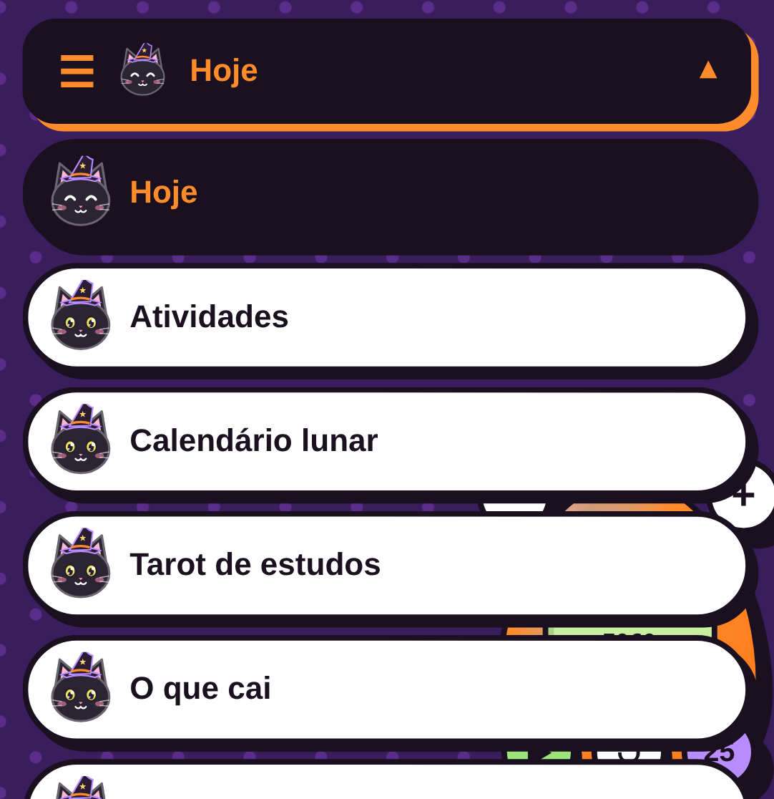

- **Nome ou apelido:** o título vira "Grimório **da** Ana", por exemplo.
- **Pronome:** **ela/dela**, **ele/dele** ou **elu/delu**. O Grimório usa o seu pronome no título ("Grimório **da**/**do**/**de** …") e nas mensagens (bem-vinda, bem-vindo, bem-vinde).
- **Idioma:** português ou inglês.
- Clique em **Começar ✨**.

No começo o grimório está vazio. Os botões levam você para o próximo passo:

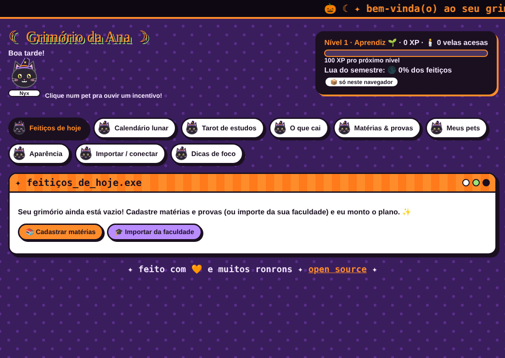

---

## 3.1 Não é só para a faculdade! 💜

"Matéria" no Grimório pode ser **qualquer área da sua vida**, e "prova" pode ser **qualquer data importante**. Exemplos:

| Matéria | Temas (viram feitiços) | "Prova" (data-alvo) |
|---|---|---|
| 🧘 Saúde | Marcar dentista · Caminhar 3x · Beber água | Consulta no dia 20 |
| 🏠 Casa | Organizar guarda-roupa · Limpar geladeira | Visita da família |
| 💰 Finanças | Listar gastos · Montar orçamento | Dia de pagar contas |
| 🎸 Curso livre / hobby | Aula 1 · Aula 2 · Praticar | Apresentação |
| 📚 Concurso / ENEM | Português · Matemática · Redação | Dia da prova |

Para a rotina e os compromissos, use as **Atividades** ([passo 7.1](#71-atividades-da-vida-toda)): elas têm **prioridade**, podem **repetir na semana** e ter **lembrete**. As "matérias" acima são ótimas quando há **vários temas até uma data** (prova, mudança, viagem…).

---

## 4. Colocar suas matérias e provas

Abra a aba **Matérias & provas** (os botões redondos com um pet são as **abas**).

### 4.1 Criar uma matéria
1. Clique em **+ Nova matéria**.
2. Clique no nome da matéria para abrir e preencha:
   - **Nome** (ex.: Cálculo I) e **Nome curto** (ex.: Cálculo);
   - **Emoji** e **Cor**, para deixar bonito;
   - **Pet professor**: qual pet "dá aula" dessa matéria;
   - **Temas**: **um por linha**. Se quiser uma explicação, use uma barra em pé: `Derivadas | regras básicas`;
   - **O que cai / anotações**: dicas sobre a prova.

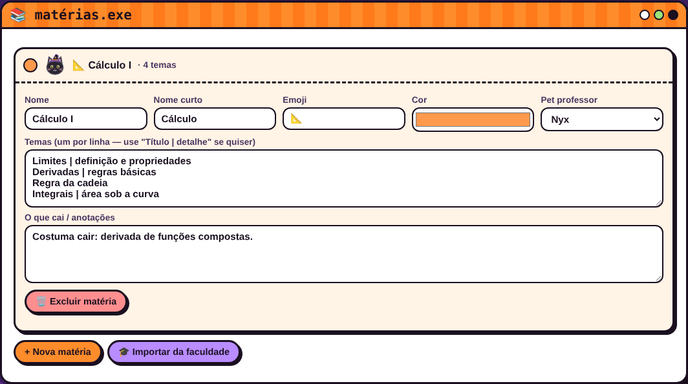

> 💡 **Os temas são o mais importante!** É com eles que o Grimório monta o plano. Copie os temas do plano de ensino ou do sumário da apostila.

Tudo é **salvo sozinho**, não precisa apertar "salvar".

### 4.2 Cadastrar as provas
Na janela **provas.exe**, clique em **+ Nova prova** e escolha a **matéria**, a **data**, a **hora** e o **local**.

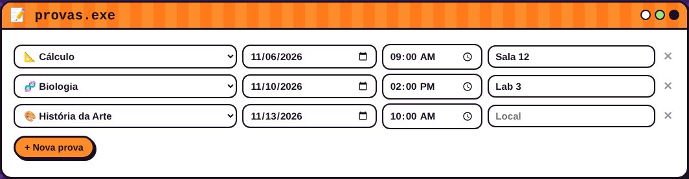

---

## 5. Importar da sua faculdade, escola ou curso

Não quer digitar tudo? Vá na aba **Importar / conectar**. Tem 4 jeitos. **Nenhum pede a senha da sua faculdade.** 🔒

### Jeito 1: colar o texto (qualquer instituição ou uso pessoal)
1. Em **Instituição**, deixe **✨ Qualquer instituição / uso pessoal**.
2. Escreva ou cole na caixa, **uma informação por linha**:

| Se você escrever… | Vira… |
|---|---|
| `Cálculo I - 06/11 09:00 - Sala 12` | 📝 prova (matéria, data, hora e local) |
| `Física` e, na linha de baixo, `13/11 às 10h30` | 📝 prova de Física |
| `O que é derivada? ;; Taxa de variação` | 🃏 carta do tarot (pergunta **;;** resposta) |
| `Limites e continuidade` (sem data) | ✨ tema (o app pergunta de qual matéria) |

3. Clique em **🔍 Analisar texto**. O Grimório mostra o que encontrou **antes** de adicionar.
4. Se estiver certo, clique em **✅ Adicionar ao meu grimório**.

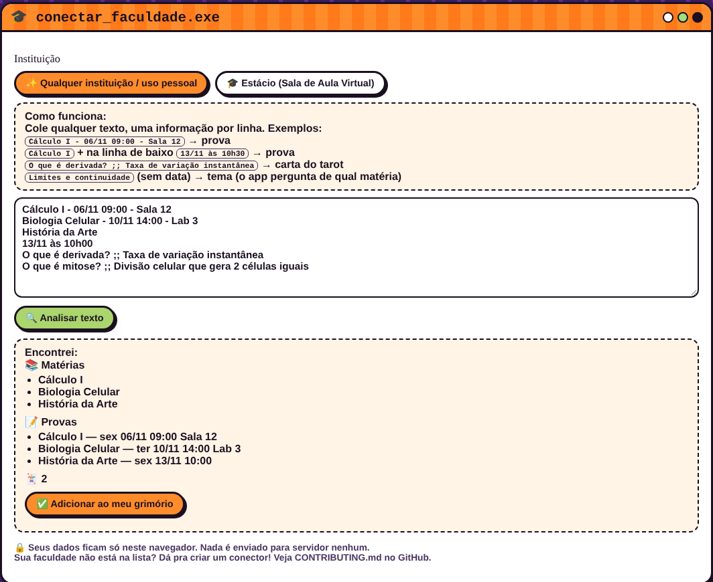

### Jeito 2: Estácio (Sala de Aula Virtual)
1. Em **Instituição**, escolha **🎓 Estácio**.
2. Em outra aba do navegador, entre em **estudante.estacio.br** normalmente.
3. Na página **Início**, aperte **Ctrl + A** (seleciona tudo) e depois **Ctrl + C** (copia).
4. Volte ao Grimório, clique na caixa, aperte **Ctrl + V** (cola) e depois **Analisar texto**. Ele encontra suas **disciplinas** e **provas agendadas**.
5. **Para os temas:** abra a disciplina → **Conteúdos** → clique em **"Mostrar mais"** até aparecer tudo → **Ctrl + A**, **Ctrl + C** → cole no Grimório. Ele pergunta de qual matéria são os temas.

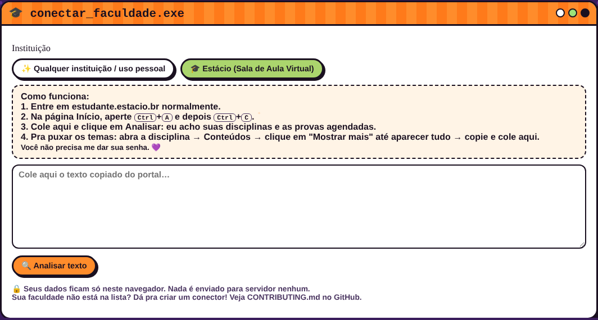

### Jeito 3: planilha (Excel / Google Planilhas)
1. Clique em **📄 Baixar modelo CSV** (janela **arquivos.exe**).
2. Abra o arquivo no Excel ou no Google Planilhas. Cada linha é uma coisa:
   - `prova` → preencha **materia, data, hora, local**
   - `tema` → preencha **materia, titulo, detalhe**
   - `carta` → preencha **materia, pergunta, resposta**
3. Salve como **CSV** e clique em **📂 Importar arquivo**.

### Jeito 4: calendário (.ics)
Se suas provas já estão no **Google Agenda**, **Outlook**, **Moodle**, **Canvas** ou **Teams**, exporte o calendário (procure por "Exportar" ou "Exportar calendário"; o arquivo termina em **.ics**) e clique em **📂 Importar arquivo**. Cada evento vira uma prova.

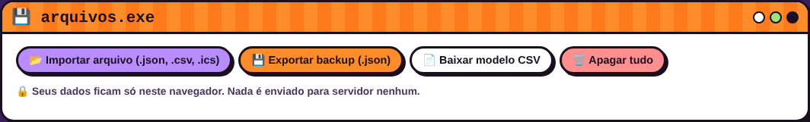

> 🤖 **Dica:** tem o plano de ensino em PDF? Peça a uma IA que você já usa (ChatGPT, Claude, Gemini…): *"transforme isso no formato do modelo CSV do Grimório, com as colunas tipo, materia, data, hora, local, titulo, detalhe, pergunta, resposta"*. Depois é só importar o arquivo. (O Grimório **não** usa nenhuma IA por dentro.)

> 👯 **Estudando com a turma?** Uma pessoa monta tudo, clica em **💾 Exportar backup** e manda o arquivo. Os colegas clicam em **📂 Importar arquivo** e recebem as matérias, os temas, as provas e as cartas prontos.

---

## 6. Gerar o plano de estudos

Na aba **Matérias & provas**, desça até **plano_de_estudos.exe**:

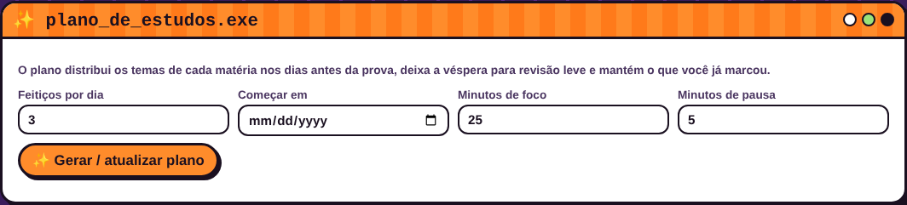

- **Feitiços por dia:** quantas tarefas por dia. Para quem tem dificuldade de foco, **2 ou 3** é ótimo.
- **Começar em:** deixe vazio para começar hoje.
- **Minutos de foco / pausa:** o tempo do timer (25 e 5 é o clássico).
- Clique em **✨ Gerar / atualizar plano**.

O Grimório espalha os temas de cada matéria nos dias **antes** da prova e deixa a **véspera** para uma revisão leve.

> 🔁 **Pode gerar de novo quando quiser** (por exemplo, se adicionou uma prova ou se pulou uns dias). Ele **guarda o que você já marcou como feito**.

---

## 7. Usar no dia a dia: aba Hoje

Abra a aba **Hoje**. Em cima aparecem as **🗓️ Atividades de hoje** (ordenadas da prioridade mais alta para a mais baixa) e embaixo os **📚 Feitiços de estudo**:

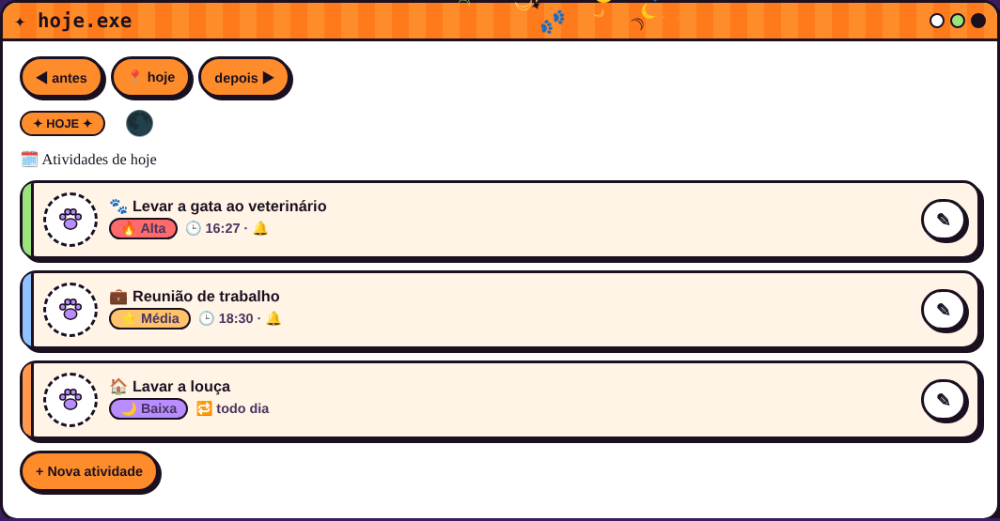

Os feitiços de estudo ficam assim:

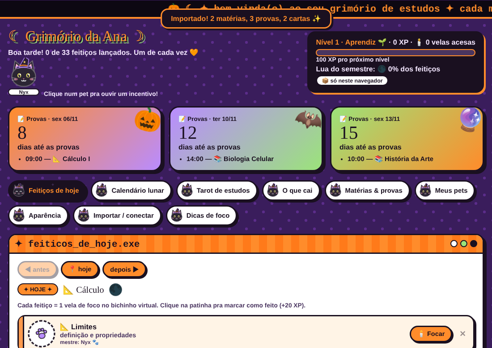

Cada feitiço tem:


- **🐾 Patinha:** clique quando terminar. O pet comemora, você ganha **+20 XP** e cai uma chuva de estrelas ✨

  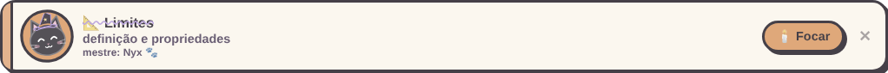

- **🕯️ Focar:** liga o timer com esse feitiço.
- **✕:** apaga o feitiço.
- Use **◀ antes / 📍 hoje / depois ▶** para ver outros dias.
- Lá embaixo dá para criar um **feitiço extra** (ex.: "Ler capítulo 3").

Completou todos do dia? **LUA CHEIA 🌕** e mais **+30 XP**!

---

## 7.1 Atividades da vida toda

Na aba **Atividades** (ou no botão **+ Nova atividade** da aba Hoje), você cadastra qualquer coisa da sua vida:

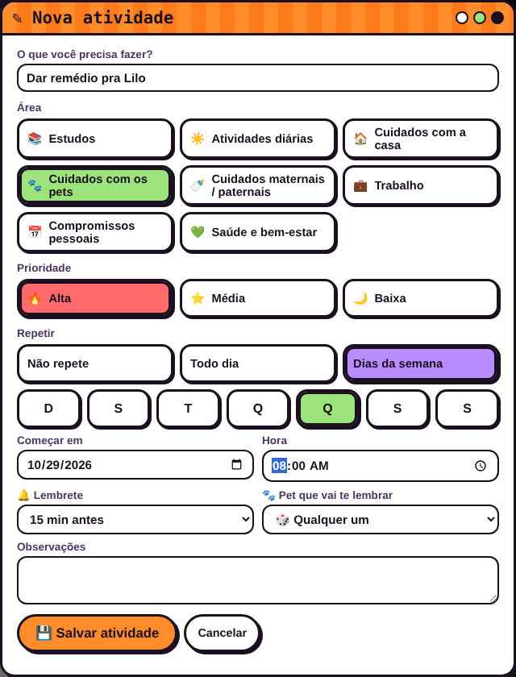

1. **O que você precisa fazer?** Ex.: "Dar remédio pro gato", "Reunião", "Lavar a louça".
2. **Área:** 📚 Estudos · ☀️ Atividades diárias · 🏠 Cuidados com a casa · 🐾 Cuidados com os pets · 🍼 Cuidados maternais/paternais · 💼 Trabalho · 📅 Compromissos pessoais · 💚 Saúde e bem-estar.
3. **Prioridade:** 🔥 **Alta** (aparece primeiro), ⭐ **Média** ou 🌙 **Baixa**.
4. **Repetir:**
   - **Não repete:** acontece só na data escolhida;
   - **Todo dia:** ex.: "Beber água";
   - **Dias da semana:** toque nos dias (D S T Q Q S S). Ex.: "Academia" na segunda, quarta e sexta.
5. **Data** (ou "Começar em", quando repete) e **Hora**.
6. **🔔 Lembrete:** sem lembrete, na hora, 5/15/30 min antes, 1 ou 2 horas antes, ou 1 dia antes. *(Precisa ter hora.)*
7. **🐾 Pet que vai te lembrar:** escolha um pet ou "Qualquer um".
8. Clique em **💾 Salvar atividade**.

Na aba **Atividades** você vê **todas**, filtra por área (os botões coloridos) e edita com o **✎**. Para marcar como feita, toque na **🐾 patinha** (+15 XP).

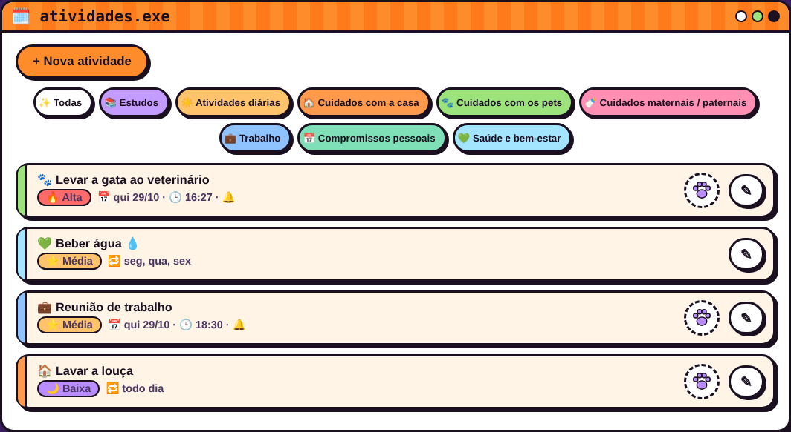

### ✅ Subtarefas (checklist)
No campo **Subtarefas**, escreva uma por linha (ex.: *Banheiro · Cozinha · Quarto*). Na aba **Hoje**, cada uma vira um quadradinho para marcar. Quando você marca **todas**, a atividade fica feita sozinha. ✨

### 📆 Semana
A aba **Semana** mostra os 7 dias (de segunda a domingo), com atividades, provas e feitiços de estudo. Toque numa atividade para marcar como feita, no **+** para criar uma nova naquele dia, ou no nome do dia para abrir o dia completo. Use **◀ semana / semana ▶** para navegar.

### 🔥 Sequência e 🏆 Conquistas
Cada dia em que você faz **pelo menos uma coisa** conta na sua **sequência** (aparece no topo: "🔥 3 dias seguidos"). Na aba **Conquistas**, seus pets ganham coroa quando você desbloqueia algo: primeiro feitiço, lua cheia, 7 dias seguidos, 10 velas de foco, 25 cartas do tarot e outras.

---

## 7.2 Lembretes com seu pet e notificações

Na hora do lembrete, **seu pet aparece na tela** com um somzinho:

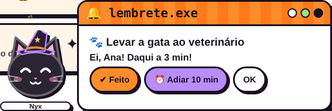

- **✔ Feito:** marca a atividade como feita;
- **⏰ Adiar 10 min:** o pet volta daqui a 10 minutos;
- **OK:** fecha o aviso.

**Notificações no celular/computador**: na aba **Atividades**, janela **lembretes.exe**, toque em **🔔 Ativar notificações** e aceite. Como funciona em cada lugar:

| Onde | Como você é avisado |
|---|---|
| 🤖 **App Android (APK)** | Notificação de verdade no celular, **mesmo com o app fechado**. |
| 💻 **Computador** (Chrome, Edge, Opera…) | O pet aparece e o navegador mostra uma notificação, **com o Grimório aberto** (pode estar em outra aba). |
| 🍎 **iPhone** | O pet aparece quando o Grimório está aberto. Abra o app algumas vezes por dia 💜 |

> 💡 Se você abrir o Grimório **depois** do horário (até 2 horas), o pet ainda te avisa do que passou.

---

## 8. O bichinho virtual (timer de foco)

Fica no canto da tela:

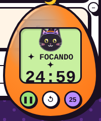

- **▶ / ❚❚:** começa ou pausa.
- **↺:** reinicia.
- **25** (botão roxo): troca o tempo (25 → 15 → 45 minutos). **Se 25 minutos parecer muito, use 15!**
- **−** e **+** (cantos de cima): **diminuem ou aumentam** o bichinho. Deixe do tamanho que for mais confortável pra você; os botões crescem junto (bom para dedos grandes!).
- Clique no pet dentro da tela para ganhar um incentivo 💕

Quando o tempo acaba, toca um somzinho, o pet **dorme** (hora da pausa 😴) e você ganha **+10 XP** e **uma vela 🕯️**.

> 📱 No celular, deixe a tela ligada enquanto o timer corre.

---

## 9. Calendário lunar

A aba **Calendário lunar** mostra todos os dias do plano. A lua de cada dia **cresce** conforme você cumpre os feitiços. Clique num dia para abrir.

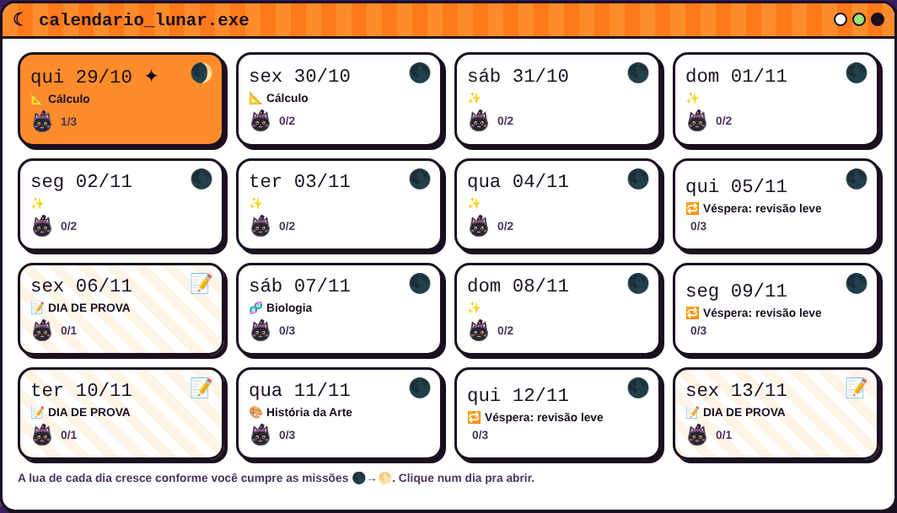

---

## 10. Tarot de estudos (flashcards)

São cartas com **pergunta na frente** e **resposta atrás**.

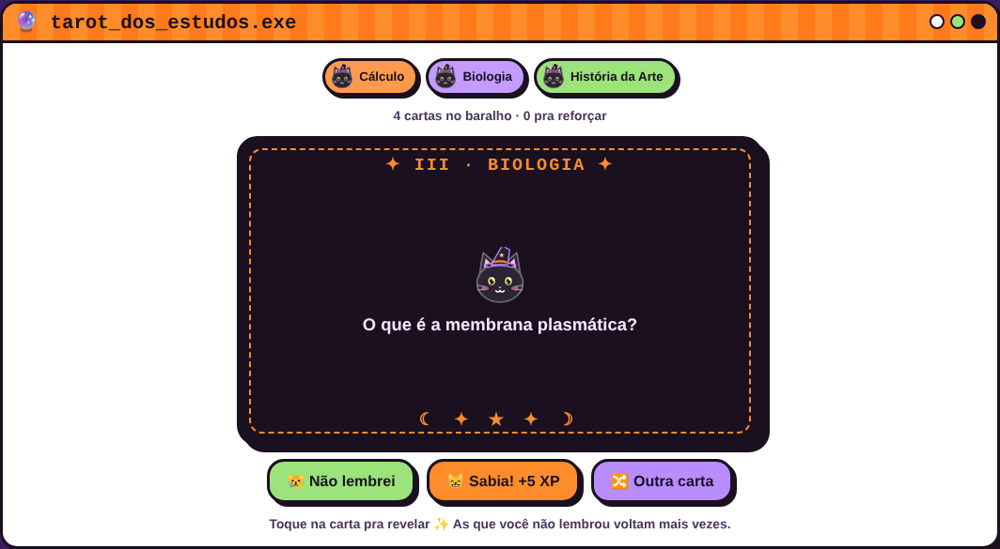

1. Leia a pergunta e tente lembrar a resposta.
2. **Toque na carta** para virar:

   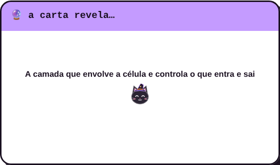

3. Clique em **😸 Sabia!** (+5 XP) ou **😿 Não lembrei**. As cartas que você não lembrou **voltam mais vezes**.
4. Os botões coloridos lá em cima filtram por matéria.

### Criar cartas
Na janela **nova_carta.exe**, escolha a matéria e escreva a pergunta e a resposta. Para criar **várias de uma vez**, escreva uma por linha usando **;;** no meio:

```
O que é mitose? ;; Divisão que gera 2 células iguais
Quem pintou a Mona Lisa? ;; Leonardo da Vinci
```

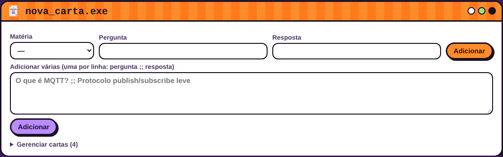

---

## 11. O que cai

A aba **O que cai** junta, de cada matéria, a data da prova, os temas e suas anotações. É ótima para **revisar na véspera**.

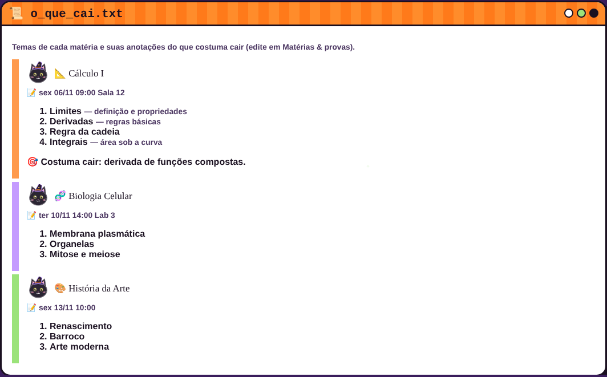

Para editar, use a aba **Matérias & provas** (campo **O que cai / anotações**).

---

## 12. Seus pets

Na aba **Meus pets** você cria pets parecidos com os seus de verdade!

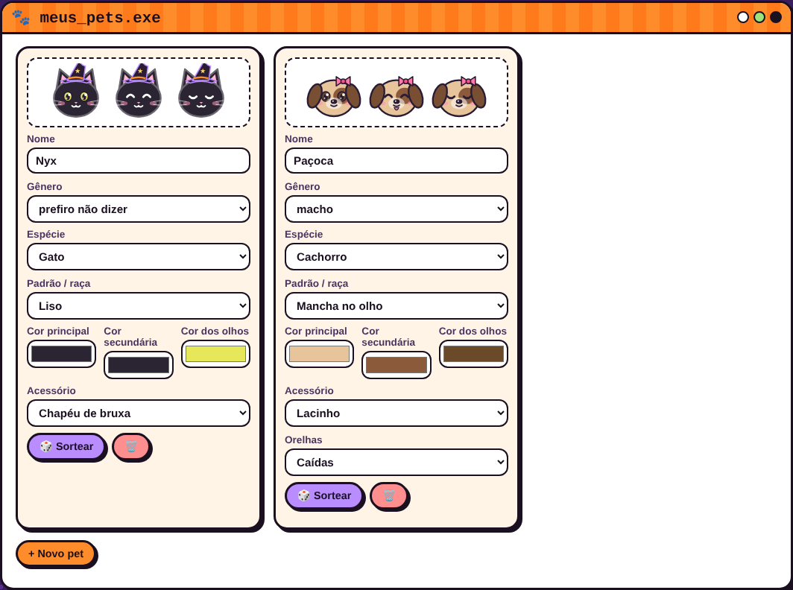

- **Espécie:** gato, cachorro, ratinho, hamster, coelho, galinha, pato, passarinho, cobra, tartaruga, sapo, peixe, morcego ou raposa.
- **Padrão / raça:** tigrado, siamês, frajola, pintado, mancha no olho…
- **Cores** (principal, secundária e dos olhos), **orelhas** (para cachorro e coelho) e **acessório** (chapéu de bruxa, laço, coroa, flor…).
- **🎲 Sortear** cria um pet aleatório.

Cada matéria pode ter um pet professor (veja o [passo 4.1](#41-criar-uma-matéria)).

---

## 13. Aparência

Na aba **Aparência**:

- **Nome ou apelido**, **pronome** (ela/dela, ele/dele, elu/delu) e **idioma**.
- **Tema pronto:** Halloween, Kawaii amarelo, Pastel goth, Floresta encantada, Oceano, Morango, Noite estrelada.
- **Cores personalizadas:** clique num quadradinho de cor para mudar. **↺ reset** volta ao tema.

  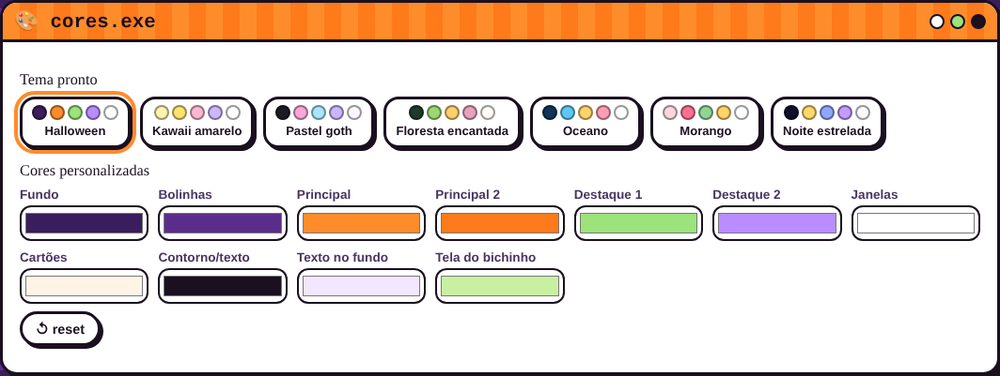

- **Formato e tamanho do bichinho virtual:** ovo, coração, chapéu de bruxa, estrela ou lua, e os botões **−/+** para o tamanho.

  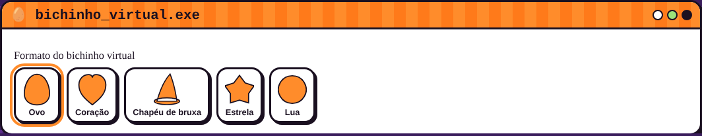

- **♿ Acessibilidade:** **A− / A+** muda o tamanho de todos os textos, e **Menos animações** desliga confetes, letreiro e brilhinhos (ótimo para quem se distrai ou sente enjoo com movimento).

---

## 14. Seus dados: onde ficam e backup

### Onde ficam meus dados?
**Só no seu aparelho**, dentro do navegador (ou do app Android). O Grimório **não tem servidor nem banco de dados**: nada é enviado para a internet, e ninguém mais vê. Ele guarda **duas cópias** no aparelho e recupera sozinho se uma sumir.

⚠️ **Mas atenção:** se você **limpar os dados de navegação**, **desinstalar o app** ou **perder o aparelho**, os dados vão junto. Por isso, **faça backup** de vez em quando (o Grimório te lembra depois de 7 dias).

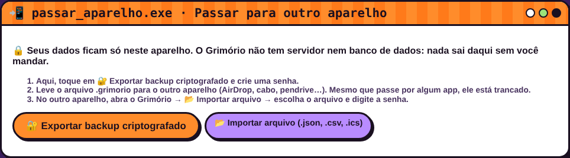

### Proteção 1: 💾 Backup automático no computador (Chrome e Edge)
Na janela **protecao_dos_dados.exe**, clique em **💾 Ativar backup automático** e escolha onde salvar o arquivo. O Grimório salva nele **sempre que algo muda**.

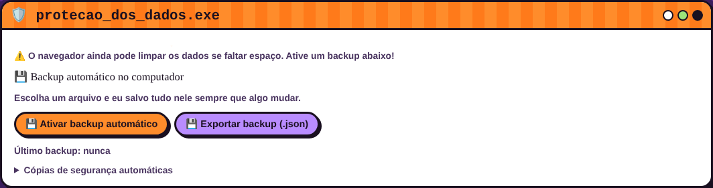

> Às vezes o navegador pede permissão de novo: aparece **⏸️ pausado**, então é só clicar em **▶️ Reativar**.

### Proteção 2: 📤 Backup manual
Clique em **💾 Exportar backup (.json)** de vez em quando e guarde o arquivo (no Drive, por exemplo). Para um arquivo que **só abre com senha**, use **🔐 Exportar backup criptografado** (gera um `.grimorio`). Para voltar, use **📂 Importar arquivo**. Se você ficar **7 dias sem backup**, o Grimório te lembra.

### Fiz besteira! Como desfazer?
Antes de importar um backup ou apagar tudo, o Grimório guarda uma **cópia de segurança**. Abra **protecao_dos_dados.exe → Cópias de segurança automáticas** e clique em **Restaurar**.

---

## 15. Passar para outro aparelho

Como tudo fica só no aparelho, para levar seu grimório do computador para o celular (ou para um aparelho novo) você usa um **arquivo trancado com senha**:

1. **No aparelho onde estão seus dados:** aba **Importar / conectar** → janela **passar_aparelho.exe** → **🔐 Exportar backup criptografado**. Crie uma senha (mínimo 8 caracteres) e **anote**.
2. Leve o arquivo **`.grimorio`** para o outro aparelho: **AirDrop**, cabo USB, pendrive… Se precisar mandar por algum app, tudo bem: o arquivo está **trancado** e só abre com a senha.
3. **No outro aparelho:** abra o Grimório → **Importar / conectar** → **📂 Importar arquivo** → escolha o arquivo e digite a senha.

> ⚠️ Os dois aparelhos **não se atualizam sozinhos**. O que você mudar num deles fica só nele, até você passar o arquivo de novo. Dica: escolha **um aparelho principal** e use o outro só para consultar.
>
> Esqueceu a senha do arquivo? Ele não abre de jeito nenhum (nem a gente consegue). Exporte um novo no aparelho original.

---

## 16. Problemas comuns

**O site não atualizou / está diferente do que eu esperava**
→ No computador, aperte **Ctrl + Shift + R**. No celular, feche o app de vez (deslize para cima) e abra de novo.

**Meu celular não mostra minhas coisas**
→ Cada aparelho tem o seu grimório. Passe os dados com um backup trancado: veja o [passo 15](#15-passar-para-outro-aparelho).

**Sumiu tudo!**
→ Calma! Tente nesta ordem: (1) **Cópias de segurança automáticas → Restaurar**; (2) **Importar arquivo** com seu último backup.

**O plano ficou com tarefas demais num dia**
→ Isso acontece quando há muitos temas e poucos dias até a prova. Na aba **Matérias & provas**, junte temas parecidos numa linha só (ex.: `Derivadas e regra da cadeia`) e clique em **Gerar plano** de novo. Você também pode apagar feitiços com o **✕**.

**O lembrete não apareceu**
→ Confira se a atividade tem **hora** e **lembrete** escolhidos. No computador e no Android pelo navegador, ative as notificações (aba **Atividades → 🔔 Ativar notificações**) e deixe o Grimório aberto. Para avisos com o app fechado, use o **app Android**.

**Pulei uns dias e o plano ficou para trás**
→ Sem culpa! 💛 É só clicar em **✨ Gerar / atualizar plano** de novo: ele redistribui o que falta a partir de hoje.

**Minha faculdade não está na lista**
→ Use **✨ Qualquer instituição**, a **planilha** ou o **calendário**. Quem sabe programar pode criar um conector para ela: veja o [CONTRIBUTING.md](../CONTRIBUTING.md).

**Encontrei um erro ou tenho uma ideia**
→ Abra uma **Issue** no GitHub: <https://github.com/sabrinadandrade/Grimorio/issues> (precisa de uma conta grátis no GitHub).

---

## 17. Dicionário de palavras difíceis

| Palavra | O que significa |
|---|---|
| **Navegador** | O programa que abre sites: Chrome, Edge, Opera, Safari, Firefox. |
| **Aba** | Cada "botão-página" do Grimório (Hoje, Atividades, Tarot…). Também é cada página aberta no navegador. |
| **Backup** | Uma cópia de segurança dos seus dados. |
| **Backup criptografado** | Um arquivo de backup trancado com senha. Sem a senha, ninguém consegue ler. |
| **Importar / Exportar** | Trazer dados de um arquivo para o Grimório / tirar os dados do Grimório para um arquivo. |
| **CSV** | Um tipo de arquivo de planilha simples (abre no Excel e no Google Planilhas). |
| **.ics** | Um arquivo de calendário (Google Agenda, Outlook…). |
| **.json** | O arquivo de backup do Grimório. |
| **Flashcard** | Cartão de pergunta e resposta para memorizar (aqui chamado de **carta do tarot**). |
| **XP** | Pontos de experiência: você ganha cumprindo tarefas e sobe de nível. |
| **Ctrl + A / C / V** | Atalhos do teclado: **selecionar tudo / copiar / colar** (no Mac, use **Cmd** no lugar de Ctrl). |

---

Feito com 🧡 e muitos ronrons. Bons estudos! ☾ ✦ ☽
